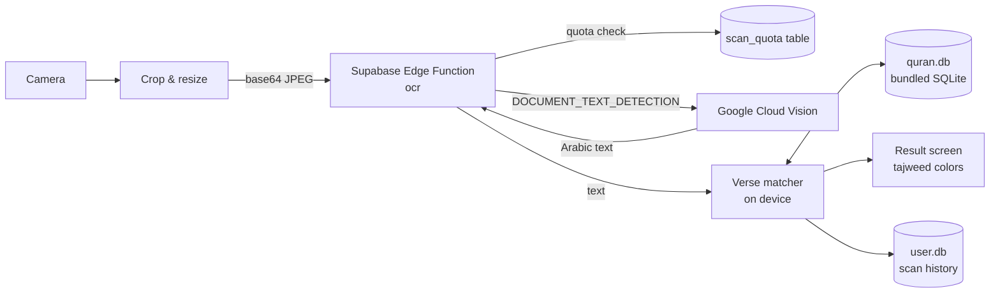

# Scan Tajwid

Take a photo of a page in a printed mushaf, and the app identifies which verses are on it and shows them with **color-coded tajweed rules**. The rules include ghunnah, idgham, ikhfa, qalqalah, madd and more, with a legend in Indonesian.

Built with Expo (React Native). It runs on Android and iOS.

- 📷 Camera capture with a draggable crop box, so you can choose which lines to read
- 🔎 Verse identification that copes with OCR errors, partial verses cut off at the edge of the photo, and ranges spanning two surahs
- 🎨 Tajweed coloring for all 6,236 verses, in the Amiri Quran font, with light and dark themes
- 🕘 Scan history stored on the device
- 🔐 The OCR API key never ships in the app; a small serverless function holds it and caps monthly usage

---

## How it works



Only OCR happens online. The whole Quran text, the search index and the tajweed markup are in a read-only SQLite database bundled with the app (`assets/db/quran.db`, about 5.5 MB), so matching and rendering run offline on the device.

### 1. Capture and crop (`src/app/scan.tsx`, `src/components/crop-view.tsx`)

1. `expo-camera` takes a photo.
2. The crop view lets the user drag the corners or move the box so only the wanted lines remain. It's built with Gesture Handler and Reanimated shared values.
3. `expo-image-manipulator` crops the photo, resizes it so its long side is at most 2048 px, and encodes it as a JPEG (quality 0.85) in base64.

### 2. OCR through the Edge Function (`src/lib/ocr.ts`, `supabase/functions/ocr/index.ts`)

The app POSTs the image to `https://<project>.supabase.co/functions/v1/ocr`, sending only the public **anon** key. The function then:

1. Rejects images over about 10 MB.
2. Calls the `consume_scan_quota(limit)` Postgres function. This is a single conditional upsert on a `scan_quota(month, count)` row, so concurrent requests can never push the count past the limit. If this month's limit is reached, it returns **HTTP 429**. The limit defaults to 1000 and is set with the `SCAN_MONTHLY_LIMIT` secret.
3. Calls Google Cloud Vision `DOCUMENT_TEXT_DETECTION` with an Arabic language hint, using the `GOOGLE_CLOUD_VISION_API_KEY` secret.
4. Returns `{ text }`.

The `scan_quota` table and the function are locked down with RLS and revoked grants, so only the Edge Function (the `service_role` key, server-side) can touch them. See `supabase/migrations/`.

### 3. Detection: from OCR text to a verse range (`src/lib/quran/`)

OCR output from a mushaf photo is noisy: missing or extra diacritics, merged or split words, misread letters, and verses cut off at the top or bottom edge. Detection works in four steps.

**a. Normalize** (`normalize.ts`)
The OCR text and every verse in the database go through the same `normalizeArabic`:
- strip harakat, Quranic annotation marks, tatweel and the superscript alef;
- unify letter variants (أ إ آ ٱ → ا, ى ئ → ي, ؤ → و, ة → ه);
- drop everything that isn't an Arabic letter or a space.

The database stores each verse already normalized (`verses.text_normalized`).

**b. Retrieve candidates** (`buildFtsQuery`, `identifyVerses`)
The 40 longest unique OCR words, which are the most distinctive ones, form an SQLite **FTS5** `OR` query. The query returns the 50 best verses ranked by BM25. This turns 6,236 verses into a short list in milliseconds.

**c. Pick the anchor verse** (`pickAnchor`)
Each candidate is located inside the OCR text by sliding a window of the verse's word count across the OCR words. Each window is scored with a normalized Levenshtein **similarity** (`1 − distance / longer length`). The reverse also works: if the photo shows only part of a long verse, the OCR text is located inside the verse instead.

Candidates are ranked by `similarity⁴ × explained length`:
- The 4th power strongly prefers accurate matches.
- *Explained length* stops a short verse that happens to appear inside a longer one from winning. For example, 3:2's text appears inside Ayat al-Kursi (2:255).
- Very short verses (like طه) are discounted, so they can't be an identification on their own.

The best candidate must reach a similarity of **0.55**, or the scan reports "not recognized".

**d. Grow the range** (`growRange`)
Starting from the anchor's position in the OCR text, the matcher tries the previous verse against the words just before that position, and the next verse against the words just after it.
- Neighbours are matched by position, so a verse elsewhere on the page can't attach by accident.
- A neighbour joins if its similarity is at least **0.6**. The window may be ±2 words off, because OCR merges and splits words.
- At the photo's edge, a neighbour may match on only its visible head or tail. That needs a stricter **0.7** similarity and at least 8 characters.
- Growth stops at the first neighbour that doesn't match, at most 30 verses each way.

Verse ids are global (1–6236), so a range can cross a surah boundary.

The result is a range `{ fromId, toId }`. It's saved to the history (`src/lib/history.ts`; `user.db`, de-duplicated per range), and the result screen opens.

### 4. Tajweed rendering (`src/lib/quran/tajweed.ts`, `src/components/tajweed-text.tsx`)

Verse text comes with tajweed markup from the Quran.com API (`<tajweed class=ghunnah>…</tajweed>`, sometimes nested).
- A stack-based parser turns it into colored runs; when tags are nested, the innermost rule wins.
- `keepMarksWithBase` moves run boundaries so a run never starts with a diacritic. Otherwise harakat would render detached from their letter.
- Each rule (17 in total) has an Indonesian name and its own light and dark colors. The legend lists only the rules used on the screen.

---

## Tech stack

| Area | Choice |
|---|---|
| App | Expo SDK 57, React Native 0.86, Expo Router, React Compiler, TypeScript |
| UI | [React Native Reusables](https://reactnativereusables.com) (shadcn/ui-style components) + NativeWind v4 / Tailwind 3 |
| Camera & images | `expo-camera`, `expo-image-manipulator` |
| Gestures | `react-native-gesture-handler`, `react-native-reanimated` |
| Data | `expo-sqlite` (bundled `quran.db` + writable `user.db`), FTS5, `fastest-levenshtein` |
| Font | Amiri Quran (`@expo-google-fonts/amiri-quran`) |
| Backend | Supabase Edge Function (Deno) + Postgres, Google Cloud Vision |

## Project structure

```
src/
  app/                  # Expo Router screens
    _layout.tsx         #   providers: gestures, theme, SQLite, fonts
    index.tsx           #   home: scan button + history
    scan.tsx            #   camera → crop → OCR → identify
    result.tsx          #   verses with tajweed colors + legend
  components/
    crop-view.tsx       # draggable crop box
    tajweed-text.tsx    # renders one verse's colored runs
    ui/                 # React Native Reusables components
  lib/
    ocr.ts              # client for the Edge Function
    history.ts          # scan history (user.db)
    quran/
      normalize.ts      # Arabic normalization (shared with the build script)
      match.ts          # anchor + range-growing matcher
      db.ts             # FTS query + verse lookups
      tajweed.ts        # markup parser + rule colors
assets/db/quran.db      # generated, committed: Quran text + FTS index + tajweed markup
scripts/build-quran-db.mjs
supabase/
  functions/ocr/        # OCR proxy with monthly quota
  migrations/           # scan_quota table + consume_scan_quota()
```

---

## Setup

### Prerequisites

- **Node.js 22.6 or newer** (the DB build script uses `--experimental-strip-types`) and npm
- A **Google Cloud** account with billing enabled (Vision has a free tier of 1,000 units a month, but still requires billing)
- A **Supabase** account (the free plan is enough)
- To build the native app: **Android Studio** with JDK 17 for Android, and/or **Xcode** on macOS for iOS

```bash
git clone <this repo>
cd scan-tajwid-app
npm install
```

### 1. Google Cloud Vision

1. Create a project at [console.cloud.google.com](https://console.cloud.google.com).
2. **Link a billing account** to that project (Billing → My projects). The free trial counts, but it must be linked to this specific project, otherwise Vision returns `403 BILLING_DISABLED`.
3. APIs & Services → Library → **Cloud Vision API** → **Enable**.
4. APIs & Services → Credentials → **Create credentials → API key**. Choose a plain API key, not OAuth or a service account.
5. Edit the key:
   - Under **API restrictions**, choose *Restrict key* and select only **Cloud Vision API**.
   - Under application restrictions, choose *None*. The key is only ever used server-side.
6. *(Recommended)* Billing → **Budgets & alerts** → create a small budget, e.g. $5 a month, with email alerts. This only notifies you. For a hard stop, cap requests per day under Cloud Vision API → **Quotas**.

> Keep this key private. It goes only into Supabase secrets, never into the app, `.env` files or commits.

### 2. Supabase backend

Create a project at [supabase.com](https://supabase.com). The project ref is the ID in the dashboard URL (`/dashboard/project/<project-ref>`). Then, from this folder:

```bash
npx supabase login
npx supabase link --project-ref <project-ref>
npx supabase db push                     # creates scan_quota + consume_scan_quota()
npx supabase secrets set GOOGLE_CLOUD_VISION_API_KEY=<your key>
npx supabase secrets set SCAN_MONTHLY_LIMIT=1000   # optional, default 1000
npx supabase functions deploy ocr
```

If your project only has the new `sb_publishable_…` keys and the function answers **401**, redeploy with `npx supabase functions deploy ocr --no-verify-jwt`.

### 3. Connect the app

```bash
cp .env.example .env.local
```

Fill in `.env.local` from Supabase → **Project Settings → API**:

```
EXPO_PUBLIC_SUPABASE_URL=https://<project-ref>.supabase.co
EXPO_PUBLIC_SUPABASE_ANON_KEY=<anon / publishable key>
```

Use the **anon / publishable** key only, never the `service_role` or secret key. Everything prefixed `EXPO_PUBLIC_` is embedded in the app binary, and the anon key is designed to be public. `.env.local` is git-ignored.

### 4. Run in development

```bash
npx expo start
```

Then open the app in **Expo Go** by scanning the QR code, or in a development build (`npx expo run:android` / `npx expo run:ios`). If the home screen shows the red "OCR belum dikonfigurasi" banner, `.env.local` is missing; restart the dev server after creating it.

In development builds, the home screen also has a **match tester**: paste Arabic text and run the matcher without the camera or OCR.

---

## Building the app

The Supabase values in `.env.local` are **baked in at build time**, so fill them in before building. The `ios/` and `android/` folders are generated by Expo (Continuous Native Generation) and are git-ignored. Configure native settings in `app.json`, never by editing those folders.

If you fork this project, change `ios.bundleIdentifier` and `android.package` in `app.json` to your own ID first.

### Android (APK)

1. On the phone, enable **Developer options** (tap Build number 7 times), then turn on **USB debugging**.
2. Connect the phone and check it appears in `adb devices`.
3. Build and install:

   ```bash
   npx expo run:android --variant release
   ```

The APK is written to `android/app/build/outputs/apk/release/app-release.apk`. You can send it to any Android phone and install it there (allow "install unknown apps"; tap Play Protect → *Install anyway*).

To build without a phone attached: `npx expo prebuild -p android && cd android && ./gradlew assembleRelease`.

> Release builds are signed with the debug keystore from the Expo template. It's fine for personal sideloading, but it's public. For wide distribution, use your own keystore through a config plugin or EAS.

### iOS (your own iPhone)

1. Add your Apple ID in Xcode → Settings → Accounts. A free account gives you a "Personal Team".
2. Plug in the iPhone, tap **Trust**, and turn on **Settings → Privacy & Security → Developer Mode**.
3. One-time signing setup ([Expo guide](https://github.com/expo/fyi/blob/main/setup-xcode-signing.md)):
   1. Run `npx expo prebuild -p ios` if `ios/` doesn't exist yet, then `xed ios`.
   2. Select the **ScanTajwid** target → **Signing & Capabilities**.
   3. Tick **Automatically manage signing** and choose your team.

   To keep the team across regenerations, set `ios.appleTeamId` in `app.json`.
4. Build and install:

   ```bash
   npx expo run:ios --device --configuration Release
   ```

5. On first launch, trust the developer under **Settings → General → VPN & Device Management**.

With a free Apple ID, the app expires after **7 days**; rerun the command to renew it, and scan history is kept. Sharing with others needs a paid Apple Developer account (Ad Hoc or TestFlight). EAS Build (`npx eas-cli@latest build`) is an alternative to local builds.

---

## Rebuilding the Quran database

`assets/db/quran.db` is committed, so you normally don't need this. To regenerate it from the [Quran.com API v4](https://api-docs.quran.foundation):

```bash
npm run build:quran-db
```

The script downloads all chapters, the Uthmani text and the Uthmani tajweed markup. It writes the `chapters`, `verses` and `verses_fts` (FTS5) tables. After rebuilding, **bump `QURAN_DB_NAME`** in `src/lib/quran/db.ts` (e.g. `quran-v2.db`). `expo-sqlite` only copies the bundled asset when that name is new, so without the bump, devices keep the old file.

---

## Troubleshooting

| Symptom | Cause / fix |
|---|---|
| Red "OCR belum dikonfigurasi" banner | `.env.local` missing or empty. Restart the dev server, or rebuild the native app |
| "Tidak ada koneksi" while the phone is online | The Supabase project is **paused**: free projects pause after 7 days without use. Restore it in the dashboard |
| "OCR failed" (502) | Check Supabase → Edge Functions → `ocr` → Logs for the `Vision error` line. Usually billing isn't linked to the Google project, the Vision API isn't enabled, or the key is wrong |
| "Quota check failed" (500) | `npx supabase db push` wasn't run |
| 401 from the function | Redeploy with `--no-verify-jwt` (projects with only `sb_publishable_` keys) |
| "Kuota scan bulan ini habis" | The monthly limit was reached. Raise `SCAN_MONTHLY_LIMIT` |
| Verses not recognized or wrong | Crop tighter around the lines and retake with better light. Thresholds are at the top of `src/lib/quran/match.ts` |
| iOS: `codesign wants to access key…` keeps reappearing | Run `security set-key-partition-list -S apple-tool:,apple:,codesign: -s ~/Library/Keychains/login.keychain-db` in Terminal, or allow all applications on the private key in Keychain Access. If your password is rejected, the login keychain password is out of sync with your Mac password |
| Native build fails after changing packages | `npx expo prebuild --clean`, then build again |

## Development

```bash
npx expo lint        # lint
npx tsc --noEmit     # typecheck
```

UI components come from React Native Reusables: `npx @react-native-reusables/cli@latest add <component>` puts them in `src/components/ui/`.

## Credits

- Quran text and tajweed markup: [Quran.com / Quran Foundation API](https://api-docs.quran.foundation)
- Font: [Amiri Quran](https://github.com/aliftype/amiri) by Khaled Hosny (SIL Open Font License)
- UI: [React Native Reusables](https://github.com/founded-labs/react-native-reusables)
- OCR: Google Cloud Vision
